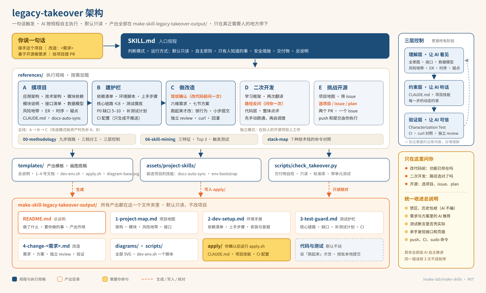
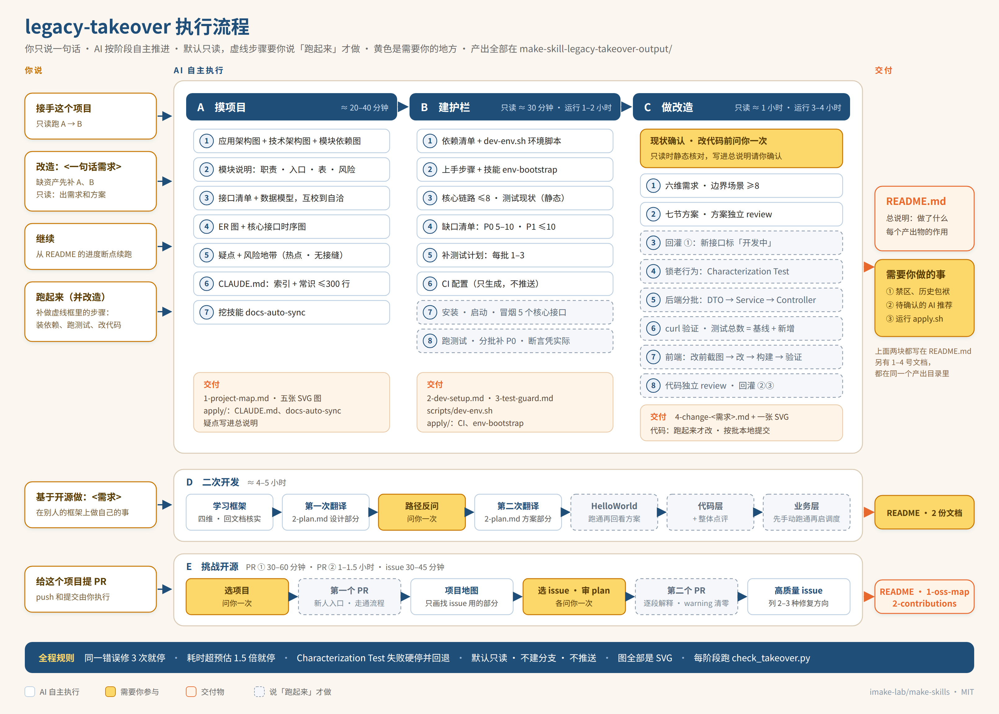

# legacy-takeover

**接手跑了多年的陌生老项目：放进去，说一句话，AI 把项目看清、把护栏和改造方案写好，交给你几份关键文档。默认只读，不动你的项目。**

[](LICENSE)


> 老项目改造的本质没变，仍然是「理解 + 开发」。AI 改变的是每一步由谁来做。AI 是加速，不是兜底。

一套用 AI 接手、加固、改造老项目的完整执行规程，以 Claude Code 技能的形式提供。它是 [make-skills](../README.md) 技能合集的一员。

## 目录

- [它解决什么问题](#它解决什么问题)
- [你会得到什么](#你会得到什么)
- [默认只读](#默认只读)
- [架构](#架构)
- [流程](#流程)
- [快速开始](#快速开始)
- [怎么用](#怎么用)
- [人和 AI 的分工](#人和-ai-的分工)
- [安全边界](#安全边界)
- [自检脚本](#自检脚本)
- [目录结构](#目录结构)
- [方法论](#方法论)
- [适用范围与限制](#适用范围与限制)
- [路线图](#路线图)
- [参与贡献](#参与贡献)
- [License](#license)
- [关于作者](#关于作者)

## 它解决什么问题

同一个 AI 编程工具，有人用来改老项目改得很稳，有人改完就出事。差别不在工具，而在用法。

AI 进到老项目里，就像一个技术不差、但对这个项目一无所知的新同事。它读代码很快，可它看不到代码之外的东西：
- 谁在用这个接口；
- 哪段奇怪的代码不能删；
- 这个功能其实早就有了。

在老项目里，事故的源头往往就藏在这里。

典型的翻车有三种：
- 直接把代码贴给 AI，问「这个项目是做什么的」，然后让它改，上线后炸在一个没人告诉它的隐性约定上；
- AI 写的测试按「应该怎样」来断言，老代码的真实行为根本没有被锁住，改坏了也发现不了；
- 需求、方案、代码全部做完，才发现这个功能早就存在。

legacy-takeover 把规避这些问题的做法，固化成了一套 AI 能自己执行的规程：
- 先让 AI 把项目看清，沉淀成它每次启动都会读的资产；
- 再把护栏建起来：知道怎么跑起来，知道哪些核心链路没有测试兜底，有补测试计划，有 CI；
- 然后才动手改。先出需求和方案，关键决策交给人；真改代码时小步走、断言凭实际运行结果写。

## 你会得到什么

把技能放进老项目，说一句「接手这个项目」，AI 会自主跑完前两个阶段。给出一句话需求，它会继续完成第三个阶段。所有产出都在项目根目录下的 **`make-skill-legacy-takeover-output/`** 里，按编号读就行：

```text
make-skill-legacy-takeover-output/
├── README.md               总说明：做了什么、需要你做的事、待你确认的推荐、每个产出的作用（先看这个）
├── 1-project-map.md        项目地图：应用架构、技术架构、模块说明、风险地带、模块依赖、外部依赖、接口清单、数据模型、核心时序
├── 2-dev-setup.md          环境手册：依赖清单、新人上手步骤、安装和启动记录、冒烟结果
├── 3-test-guard.md         测试护栏：核心链路（≤8 条）、测试现状、缺口（P0 5–10 个）、补测试计划、CI
├── 4-change-<需求>.md       改造：六维需求、七节方案（决策点集中在第 7 节）、独立 review、验证（每个需求一篇）
├── diagrams/               应用架构图、技术架构图、模块依赖图、ER 图、时序图、改造链路与流程图，全部是 SVG
├── scripts/dev-env.sh      一个脚本管环境：install / start / stop / status
└── apply/                  要放进项目固定位置才能起作用的文件
    ├── apply.sh            你确认后运行：复制到位，已存在的跳过，不覆盖
    ├── CLAUDE.md                          → 项目根目录（索引 + 常识，≤300 行）
    ├── .claude/skills/docs-auto-sync/     → 项目专属技能：改完代码查文档是否对得上
    ├── .claude/skills/env-bootstrap/      → 项目专属技能：一键准备本地环境
    └── .github/workflows/test.yml         → CI 配置
```

接手一个项目大约是 **5 篇文档、5 张图、1 个脚本，加上 apply/ 里的 5 个文件**。每多一个改造需求，多一篇文档和一张图。删掉这个文件夹，就能干净地撤掉全部产出。

| 阶段 | 写在哪 |
| --- | --- |
| **A 摸项目** | `1-project-map.md`（含模块说明：每个模块的职责、入口、核心类、表、依赖、改动风险；含风险地带：改动热点、无接缝老代码、对外接口、跑批、无测试的核心链路，≤15 条）、应用架构图、技术架构图、模块依赖图、ER 图、时序图、`apply/CLAUDE.md`、docs-auto-sync；疑点清单在总说明里 |
| **B 建护栏** | `2-dev-setup.md`、`3-test-guard.md`、`dev-env.sh`、env-bootstrap、CI 配置 |
| **C 做改造** | `4-change-<需求>.md`（方案和代码各过一次独立 review：兼容性、安全、性能三个视角）、改造链路与流程图 |
| **D 二次开发** | `1-framework-map.md`（框架地图）、`2-plan.md`（设计 + 技术方案）、边界图、运行链路图 |
| **E 挑战开源** | `1-oss-map.md`（项目地图）、`2-contributions.md`（候选 issue、PR 描述、issue 正文、要你执行的命令） |

- **AI 不往文件夹外面写东西**。CLAUDE.md、项目技能、CI 配置先放在 `apply/` 里，你看过以后运行 `bash make-skill-legacy-takeover-output/apply/apply.sh` 放到位，加 `--dry-run` 可以先看会做什么。
- **只有你说「跑起来」以后**，补的测试和改造代码才会写进项目原有的源码和测试目录。它们在当前分支上按批本地提交，提交信息以 `takeover:` 开头，总说明里逐条列出。

## 默认只读

老项目在新环境里经常跑不起来：运行时版本对不上、私服连不上、中间件缺配置。一上来就装依赖、起服务，很容易卡住，还可能弄乱你的机器。所以 **legacy-takeover 默认只读**：

| | 只读（默认） | 运行（你说「跑起来」） |
| --- | --- | --- |
| AI 做什么 | 读代码、看 git 历史、写文档 | 另外安装依赖、编译、启动、调接口、跑测试、写测试和代码 |
| 对项目的影响 | 除了产出文件夹，什么都不改 | 测试和代码按批本地提交，不推送 |
| 环境手册 | 依赖和步骤从配置推出来，标「未实测」 | 实测过，有安装、启动、冒烟记录 |
| 测试护栏 | 核心链路、静态测试现状、缺口、补测试计划 | 另外有实际运行结果和补好的 P0 测试 |
| 改造 | 需求、方案、待验证清单，不改代码 | 改代码、补测试、curl 验证、前端截图、回灌文档 |

只读做完以后再说「跑起来」，AI 会接着进度把跳过的部分补上，写进同一份文档，不另建文件。

**只读方式下，测试护栏只是计划，不是护栏。** 总说明开头会写明「护栏状态：只有计划，未实测」。真要改代码，先说「跑起来」，让兜底测试先跑通。

## 架构



- **入口**：`SKILL.md` 负责判断模式、管理进度、定下自主原则和停止点。
- **执行规格**：`references/` 下有五个阶段的规格，按需加载。A → B → C 是主线；D、E 是在别人的开源项目上工作的独立模式。
- **资源**：模板、要装进项目的技能、自检脚本。
- **产出**：全部放在 `make-skill-legacy-takeover-output/` 里，总说明 `README.md` 加 1–4 号文档。
- **右侧**：上方是贯穿所有阶段的三层控制；下方是整个流程里仅有的几处人工介入。

两张图的源文件都是手写 SVG（[architecture.svg](images/architecture.svg)、[flow.svg](images/flow.svg)）。修改后重新截图：

```bash
google-chrome --headless=new --hide-scrollbars --force-device-scale-factor=2 \
  --window-size=1610,970 --screenshot=images/architecture.png images/architecture.svg
google-chrome --headless=new --hide-scrollbars --force-device-scale-factor=2 \
  --window-size=1610,1150 --screenshot=images/flow.png images/flow.svg
```

## 流程



- **主线**：A 摸项目 → B 建护栏 → C 做改造。说「接手这个项目」，AI 跑完 A、B；说「改造：<需求>」，缺的资产先补齐，再进 C。默认只读，虚线框里的步骤要你说「跑起来」才做。
- **独立模式**：D 是在别人的开源框架上做自己的需求；E 是给开源项目贡献 PR 和 issue。
- **黄色节点**：整个流程里仅有的几处需要问你的地方，其余全部由 AI 自主推进。
- **底部蓝条**：贯穿全程的硬规则。

## 快速开始

### 要求

- [Claude Code](https://docs.claude.com/en/docs/claude-code)（技能按 Claude Code 的 Skill 格式编写）
- Python 3.8+（只有自检脚本用到，只依赖标准库）
- 目标项目是一个 git 仓库
- 只读方式不需要项目能在本机跑起来；想让 AI 跑起来、补测试、改代码时，本机要能装项目需要的运行时
- 可选：Chrome 或 Chromium。用来给 AI 画的 SVG 截图自检，有它的话，AI 会截图检查图里有没有文字溢出、重叠。没有也能用，图照样是 SVG

### 安装

**装到某一个项目里**（推荐，只在这个项目里生效）：

```bash
git clone https://github.com/imake-lab/make-skills.git
mkdir -p <你的老项目>/.claude/skills
cp -r make-skills/legacy-takeover <你的老项目>/.claude/skills/
```

**装到用户级**（所有项目都能用）：

```bash
git clone https://github.com/imake-lab/make-skills.git
mkdir -p ~/.claude/skills
cp -r make-skills/legacy-takeover ~/.claude/skills/
```

装完以后**完全退出 Claude Code 再重新启动**，技能才会被识别。

### 第一次运行

在老项目根目录启动 Claude Code，说：

```text
接手这个项目
```

阶段 A 大约 20–40 分钟，阶段 B 只读大约 20–40 分钟。跑完以后打开 `make-skill-legacy-takeover-output/README.md`，看做了什么、每个产出有什么用，然后从「需要你做的事」开始处理。

想让 AI 实际跑起来，再说一句：

```text
跑起来
```

它会装依赖、启动、冒烟、跑测试、分批补 P0 测试，大约 1–2 小时，主要时间花在补测试和等编译上。

## 怎么用

| 你说 | AI 做什么 |
| --- | --- |
| `接手这个项目` | 只读：阶段 A + B，出项目地图、环境手册、测试护栏 |
| `改造：给订单列表加一个按状态批量导出` | 只读：缺 A、B 的资产就先补齐，再出需求和方案，不改代码 |
| `跑起来` | 切到运行方式：装依赖、启动、冒烟、跑测试、补测试，结果补进原文档 |
| `跑起来并改造：<需求>` | 运行方式完成阶段 C：开工前问你一次现状，然后改代码、补测试、验证 |
| `基于这个开源项目做：<一句话需求>` | 阶段 D；路径选择会问你一次 |
| `给这个项目提 PR` | 阶段 E；选项目、选 issue、审 plan 各问你一次；push 和提 PR 由你执行 |
| `继续` | 从总说明 `README.md` 里记录的进度接着做 |

看完总说明以后，直接用自然语言反馈就行，比如：

```text
架构图少了 Redis；D2 的决策我不同意，改成方案 B；禁区我已经写进 CLAUDE.md 了。
```

AI 会同步修改所有引用到这些内容的文档，重新检查已有的方案和代码有没有受影响，再跑一遍一致性检查。

**第二次改造会快很多。** 第一次是在搭脚手架；等 `make-skill-legacy-takeover-output/` 的资产、CLAUDE.md 和一次完整的改造记录都在了，后续的需求可以把拆需求、拆方案压成一句话。但现状确认、人工审核、分批纪律这三件事，每次都不能省。

## 人和 AI 的分工

AI 承担约 70% 的体力活：读代码、画图、写文档、写脚本、写代码和测试、同步文档。下面这些判断只能由人来做。技能不会替你编造这些内容，会统一收进总说明的「需要你做的事」和「待你确认的 AI 推荐」：

| 事项 | AI 怎么处理 |
| --- | --- |
| CLAUDE.md 的「禁区」「历史包袱」 | 只写占位，一个字都不猜。把找到的线索（「不要删」的注释、没人引用却没删的代码、反复回滚的提交）整理进总说明的「疑点」 |
| 改造前确认功能是否已存在 | 先自己找证据（前端路由、菜单、组件、接口）。只读方式写进总说明请你确认；运行方式在改代码前**问你一次** |
| 业务目标、边界场景的产品决策、本期范围 | 给出推荐，标注「AI 推荐，待确认」 |
| 方案第 7 节的决策点 | 按推荐方案先做，标注「AI 推荐，待确认」 |
| 亲手验证接口和页面 | 运行方式下自己先 curl、截图并记录；把复验命令和页面路径留给你 |
| 审 AI 自己的产出 | 不让 AI 自己审自己：方案和代码各交给一个没参与设计的独立 reviewer（子代理），只给材料，从兼容性、安全、性能三个视角找问题；没采纳的高风险问题列给你确认 |

**效果不好的时候，99% 是该停的地方没停。** 先问自己三个问题：业务目标是谁定的？第 7 节的决策是真看过，还是直接点了 OK？开工前，亲手点过产品吗？

## 安全边界

- **默认只读。** 不安装、不编译、不启动、不跑测试，除了产出文件夹什么都不改。你说「跑起来」才进入运行方式。
- **不建分支，不推送。** 就在当前分支上工作。开工时记下基线提交号；运行方式下改代码前要求工作区干净，测试和改造按批本地提交，提交信息以 `takeover:` 开头，随时可以整体撤回或单批撤回。push、触发远端 CI、提 PR、提 issue、部署，都只准备好命令，由你来执行。
- **不动老代码。** 护栏阶段不改业务代码；改造阶段不重构现有方法，只调用。Characterization Test 一旦失败就硬停止，回退本批改动。
- **不越界。** 文档产出只写在 `make-skill-legacy-takeover-output/` 里，而且只写约定的那几个文件。CLAUDE.md、项目技能、CI 配置由你运行 `apply.sh` 放到位，已有的文件不覆盖，并给出合并建议。
- **不提权。** 需要 sudo、需要修改系统或全局配置的步骤，只列出命令。
- **不碰凭据。** 不读取、不打印、不提交凭据文件；自检脚本会扫描文档里有没有疑似密钥。
- **不删除。** 看起来没用的代码、表、字段、配置一律不删，只记进疑点清单。

## 自检脚本

每个阶段结束时，AI 会自动运行这个脚本。你也可以随时手动跑：

```bash
python3 .claude/skills/legacy-takeover/scripts/check_takeover.py --root .
```

它只读不写，主要核对这些：
- 交付物齐不齐，有没有多出约定以外的文件；
- `CLAUDE.md` 有没有超过 300 行；
- 清单有没有超上限：核心链路 ≤8，测试缺口 ≤20，P0 ≤10，每批补测试 ≤3；
- 改造文档的需求六维齐不齐，边界场景够不够 8 条；方案和代码有没有做独立 review；
- 风险地带有没有超过 15 条；只读方式下护栏状态有没有被写成「已建立」；
- 只读方式下有没有改代码，环境手册有没有标「未实测」；
- 方案第 7 节的决策有没有落定；
- 图是不是全部为合法的 SVG，文档里有没有残留 Mermaid 代码；
- 总说明 README.md 有没有覆盖产出目录里的每一个文件；
- `apply/` 有没有附带 `apply.sh`；
- 文档里有没有疑似密钥。

有错误时退出码为 1。规则明细见 [scripts/README.md](scripts/README.md)。

```bash
# 运行脚本自身的测试（在技能目录下执行）
python3 -m unittest discover -s scripts/tests -v
```

## 目录结构

```text
legacy-takeover/
├── SKILL.md                    入口：模式、运行方式、自主原则、停止点、交付物
├── README.md                   本文件
├── images/                     架构图和流程图（SVG 源文件 + PNG 截图）
├── LICENSE
├── references/
│   ├── 00-methodology.md       方法论：九步链路、三档分工、三层控制、三种债和三种风险
│   ├── 01-understand.md        阶段 A 摸项目
│   ├── 02-guardrails.md        阶段 B 建护栏
│   ├── 03-change.md            阶段 C 做改造
│   ├── 04-secondary-dev.md     阶段 D 基于开源二次开发
│   ├── 05-open-source.md       阶段 E 挑战开源
│   ├── 06-skill-mining.md      挖项目专属技能
│   ├── svg-diagrams.md         SVG 绘图规范与截图自检
│   └── stack-map.md            技术栈对照（Java/Node/Go/Python/Rust/.NET/PHP）
├── templates/                  总说明和 1–4 号文档的模板、dev-env.sh、apply.sh、画图底稿 diagram-base.svg
├── assets/project-skills/      装进目标项目的技能：docs-auto-sync、env-bootstrap
└── scripts/
    ├── check_takeover.py       交付物自检（只读，只依赖标准库）
    ├── README.md
    └── tests/                  单元测试
```

## 方法论

完整内容见 [00-methodology.md](references/00-methodology.md)，核心是这几条：

- **九步链路**：找人聊 → 翻资料 → 浏览代码 → 跑起来 → 摸接口 → 带疑点深挖 → 画核心链路 → 动手改 → 验收。70% 的时间花在理解上，30% 花在改造上。
- **三档分工**：AI 主导（80/20）、人机对半（50/50）、人主导（20/80）。AI 覆盖不到的那 20%，你不主动补，它就等于 0。
- **三层控制**：理解、约束、验证。三层同时起作用，并且互相喂养。
- **三种债，三种风险**：理解债、验证债、改造路径债；方向错的风险、AI 偷懒的风险、工程师跟不上的风险。
- **四个动作**：读懂陌生代码 → 建好改造前护栏 → 用提示词驱动产出 → 显式拍板关键决策点。前三个动作 AI 大量参与，第四个只能是工程师自己。
- **Characterization Test**：不测代码「应该做什么」，只锁住它「现在实际做什么」。顺序是锁行为 → 用 Seam 隔离 → 重构。

## 适用范围与限制

**适合**：
- 跑了几年、文档不全、原作者已经不在的业务系统；
- 多模块、前后端联动的项目；
- 老接口有外部调用方（SDK 客户、其他系统）的项目；
- 需要多人协作同一个功能的项目。

**不需要用**：
- 定位清楚的 bug 修复；
- 改文案或样式；
- 重构独立的工具函数；
- 加内部脚本。

**限制**：
- 规格里的示例命令以 Java / Spring / Maven 为主，其他技术栈靠 `stack-map.md` 映射，实际以项目里 CI 和 Makefile 用的命令为准。
- 只读方式下，环境手册和 env-bootstrap 里的命令是从配置推出来的，没有实测，第一次执行时可能要修正。
- AI 能不能每一步都照规程执行，没有任何系统能百分之百保证。自检脚本和总说明能降低漏做的概率，消除不了。
- 技能按 Claude Code 的 Skill 格式编写。其他智能体可以让它直接读 `SKILL.md` 后按规程执行，但不会被自动触发。
- 当前是 **v0.1 草稿**，还没有在大量真实项目上验证过。

## 路线图

- [ ] 在一个公开的开源老项目上完整跑一遍 A → B → C，公开全部产出作为示例
- [ ] 收集不同技术栈的实测结果，补充 `stack-map.md`
- [ ] 一致性检查补上「文档 ↔ 代码」的自动比对（目前由 docs-auto-sync 技能完成）
- [ ] 更多技能

## 参与贡献

欢迎提 issue 和 PR，尤其是这些：
- 在你的项目上跑过以后发现的漏洞（请附上技术栈、阶段、实际现象）；
- 新技术栈的对照条目；
- 自检脚本的规则和测试。

提交 PR 前，请先在技能目录下跑通 `python3 -m unittest discover -s scripts/tests`。改动模板的标题或表头时，同步修改 `check_takeover.py` 和它的测试。

## License

[MIT](LICENSE) © 2026 马克

## 关于作者

马克LAB。扛过大型系统的架构师，十几年技术，带过几十人团队。公开记录用 AI 编程做真项目，含翻车现场。

- X：[@imakelabs](https://x.com/imakelabs)
- 网站：[imakelabs.net](https://imakelabs.net)

本项目与 Anthropic 没有隶属、背书或合作关系。Claude Code 是 Anthropic 的产品，文中出现这个名称，只用于说明兼容方式。
